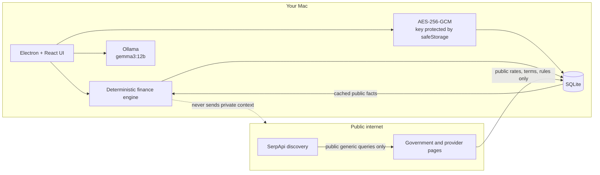

# Slowth Money

Slowth Money is a calm, local-first Canadian savings and goal-planning desktop app. It helps answer four questions without turning personal finance into another feed to monitor:

- Am I on track?
- Do I need to do anything?
- Is the benefit worth my attention?
- What evidence supports that conclusion?

The hackathon MVP runs as an Electron app on macOS, keeps the private financial profile encrypted locally, performs financial math in deterministic TypeScript, and uses an open-weight model through local Ollama only when language reasoning adds value.

> The internet knows what financial products exist.  
> The local model knows your financial situation.  
> Neither external search services nor financial providers need to know both.

## What works

- An editable Canada-focused profile with explicit unknown states for TFSA room, FHSA eligibility/room, and RRSP room.
- One primary goal with deterministic progress, required monthly savings, projected target balance, and completion date.
- AES-256-GCM encrypted private records in SQLite; the random key is protected by Electron `safeStorage`.
- A local `gemma3:12b` planning conversation for questions about goals, cash flow, tradeoffs, missing inputs, and cached financial offers.
- Validated natural-language profile patches remain available as a focused quick-edit tool. Changes are proposed before they can be applied.
- Separate account-wrapper and financial-product models.
- Isolated official-page provider adapters, public-source provenance, partial refresh results, and local freshness state.
- Seven-day product and 30-day Canadian-rule refresh policies, evaluated on launch and hourly while the app is awake.
- A laziness threshold that suppresses interruptions when a deterministic benefit is too small or eligibility is materially unknown.
- Native notifications for meaningful opportunity, expiry, and milestone events.
- Offline access to profiles, projections, cached products, activities, and local Ollama.
- A clearly labelled demo mode with quiet, promotion-expiry, ~$250 opportunity, and 50% milestone scenarios.
- Local JSON profile export/import with an explicit sensitivity warning.

Slowth Money never connects to online banking, asks for credentials, moves money, opens accounts, submits provider forms, trades securities, or guarantees outcomes.

## Privacy architecture



Private values are not accepted by the public-search query builder. The renderer is sandboxed and reaches local capabilities only through a narrow, context-isolated preload API. Decrypted profile values and API keys are not logged. Public products retain source URL, source type, retrieval time, verification time, and confidence.

See [docs/architecture.md](docs/architecture.md) for domain boundaries, the database schema, failure model, and implementation phases.

## Stack

- Electron, React, Vite, and strict TypeScript
- SQLite through `better-sqlite3`
- Zod validation at persistence, IPC-adjacent, external-data, and model-output boundaries
- Ollama with `gemma3:12b` by default
- SerpApi abstraction for public discovery
- Vitest unit and integration tests
- Playwright Electron smoke flow

Money is represented as integer cents. Rates use decimal fractions. Material unknowns stay `null` or `UNKNOWN` from storage through planning and presentation.

## Local setup

Requirements:

- Apple Silicon or Intel Mac with Node.js 22+
- pnpm 10+
- Optional: Ollama for local planning conversations and conversational profile updates
- Optional: a SerpApi key for discovery (official provider adapters do not require one)

```bash
pnpm install
pnpm dev
```

The install and command lifecycle rebuilds `better-sqlite3` for the runtime about to use it. This matters when the shell's Node.js runs under Rosetta while Electron runs natively on Apple Silicon: `pnpm test` temporarily targets Node, then restores the Electron-native module before it exits.

The app opens in obvious demo mode when no real profile exists. Go to **Settings → Use my own data** to create a separate encrypted profile.

### Run and package the Electron app on macOS

The `pnpm dev` command above starts Electron with renderer hot reload for day-to-day development.

To compile the main process, preload script, and React renderer, then run those production bundles in Electron:

```bash
pnpm build
pnpm preview
```

To create a runnable macOS `.app` without building an installer:

```bash
pnpm package:mac:dir
open "release/mac-arm64/Slowth Money.app"
```

The unpacked application is written to `release/mac-arm64/Slowth Money.app`. To create a DMG instead, run:

```bash
pnpm package:mac
```

The current packaging scripts target Apple Silicon (`arm64`). Development mode can still run on an Intel Mac with a compatible Electron installation, but distributing an Intel or universal build requires adding `x64` or `universal` targets to the Electron Builder configuration. Locally produced builds are not signed or notarized, so they are intended for development and personal testing rather than public distribution.

### Ollama and Gemma

Install [Ollama](https://ollama.com/), then:

```bash
ollama pull gemma3:12b
ollama serve
```

Slowth Money defaults to `http://127.0.0.1:11434` and only accepts a loopback Ollama URL, preventing accidental transmission of private prompts to a remote host. Both the base URL and model name can be changed in advanced settings. **Ask Slowth** combines the encrypted local profile, deterministic goal and offer calculations, and cached public products only inside the local Ollama request. Product citations shown in the UI are resolved from local cache IDs, never model-generated URLs. Conversations are kept in renderer memory and are not persisted. If Ollama or the model is missing, deterministic planning and cached public information keep working.

### SerpApi

Enter a SerpApi key in Settings. It is stored inside the encrypted private settings record. The search layer only accepts branded public queries created from public fields such as jurisdiction, product category, and month; it never receives a `FinancialProfile`. When product data is stale, Slowth Money uses one generic SerpApi discovery query before checking the configured official provider pages. **Settings → Demo lab → Refresh offers with SerpApi** triggers the same process immediately and reports the discovery count and provider-refresh result.

## Commands

```bash
pnpm dev          # Electron + renderer development
pnpm build        # production bundles
pnpm preview      # run the compiled bundles in Electron
pnpm package:mac:dir # create an unpacked ARM64 macOS app
pnpm package:mac  # create an ARM64 DMG
pnpm typecheck    # strict TypeScript
pnpm test         # unit and integration tests
pnpm test:e2e     # Playwright Electron demo smoke flow
pnpm lint         # type-aware ESLint
pnpm validate     # typecheck, tests, lint, and build
```

No automated test contacts a live bank, SerpApi, or Ollama. Provider tests use deterministic HTML fixtures and verify partial-failure isolation.

## Public-data model

Trust descends from government/regulator, to financial institution, established comparison source, publication, general web, then forum/social source. Search is discovery, not truth. Consequential facts prefer official pages; conflicts between high-quality sources are marked rather than hidden.

Current adapters check a small set of official Canadian provider pages. Web pages change frequently: an adapter that cannot verify its target returns a warning or failure, leaves the old cache intact, and cannot manufacture a rate. A partial provider failure does not discard valid products from other providers.

Canadian educational concepts link to CRA and CDIC sources. Time-sensitive contribution limits are intentionally not embedded in prompts. Personal contribution room and eligibility always come from the user or remain unknown.

## Demo mode

Demo mode never writes fixture information into the real encrypted profile. The banner can deterministically simulate:

1. no meaningful opportunity;
2. a promotion-expiry warning;
3. an opportunity worth about $250;
4. goal progress crossing 50%.

The included product is explicitly identified as a fixture, not a live offer. Native notification buttons live under Settings → Demo lab.

## Current limitations

- Canada is the only country pack.
- Provider HTML extraction is deliberately narrow and may require maintenance as official pages change.
- SerpApi discovery is implemented behind a replaceable interface; the MVP UI currently emphasizes direct official-page refreshes.
- Country-rule refresh verifies authoritative source availability and provenance; it does not yet extract every rule into a complete legal knowledge base.
- One primary goal is supported.
- Ask Slowth conversations are intentionally session-only and do not yet support saved conversation history.
- The MVP does not integrate with banks or automatically confirm personal eligibility.
- Local macOS packaging is configured; public distribution still requires Apple signing and notarization.

## Troubleshooting secure local storage

If macOS can no longer decrypt `slowth-money.key` after an Electron identity, architecture, or Keychain change, Slowth Money does not silently erase encrypted data:

- When the database contains no encrypted records, the unreadable key is preserved beside the replacement as `slowth-money.key.unreadable-<timestamp>` and startup continues.
- When encrypted records exist, startup stops with a recovery message. Restore the matching macOS Keychain/user-data backup before retrying. To intentionally start over, first back up and then remove the Slowth Money folder under `~/Library/Application Support/`; this permanently abandons the encrypted profile.

Never share either the database or protected-key files. They may contain or unlock sensitive financial information.

## Financial safety

Slowth Money is educational planning software, not financial advice. Numerical projections are deterministic estimates based on supplied values and stated assumptions. Rates, promotions, account-wrapper support, contribution room, eligibility, taxes, and deposit-insurance treatment must be verified with authoritative sources before acting.

## Roadmap — documentation only

Future exploration may include personal investment-planning context, retirement scenarios, tax-aware analysis, and a concise human financial-advisor brief summarizing changes since the last review. The MVP does **not** implement securities recommendations, trading, portfolio rebalancing, or automated transactions.

The long-term intent is not necessarily to replace an advisor: a private local agent could maintain context continuously and help a person arrive at an advisor meeting with clearer facts and better questions.
